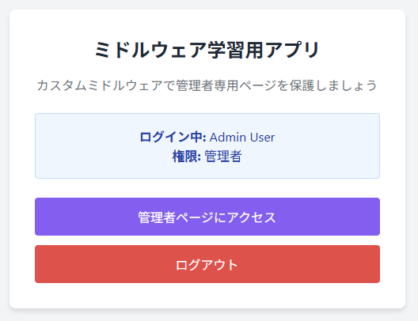
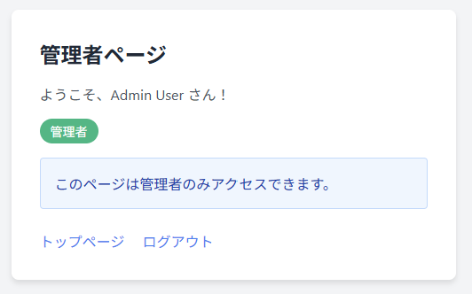
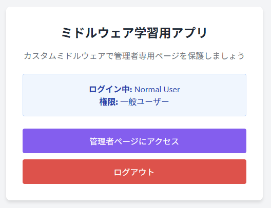

# middleware-app-practice

## 概要
COACHTECH 教材 Tutorial 10-2「ミドルウェア ハンズオン演習」で作成した成果物です。
スターターキットをcloneし、管理者のみ管理者ページに遷移できるように制限するためのミドルウェアを追加で実装しました。

## 使用技術
- PHP 8.5.12
- Laravel 10.50.0
- カスタムミドルウェア
- Laravel Fortify（認証）

## 学んだこと
- ミドルウェアを活用してHTTPリクエストがコントローラに届くまで、またHTTPレスポンスがブラウザに届く前に処理をはさむ方法
- カスタムミドルウェアを作成して app\Http\kernel.php に登録する方法
- ルートでミドルウェアを使用してアクセス制限などを適用する方法

## 動作確認
1. スターターキットをcloneする
2. middleware-app-practiceディレクトリ上でsail up -dコマンドによりyamlファイルに記述した構成通りのコンテナを起動させてネットワークで連携
3. sail artisan migrate --seedコマンドによりテーブルを作成して初期値を代入
4. ブラウザで「`http://localhost`」のURLにアクセスして以下のそれぞれの項目を確認
   - admin@example.com, password でログインし、「管理者ページにアクセス」押下で遷移可能
   - user@example.com, password でログイン、「管理者ページにアクセス」押下で403エラー表示
5. 必要に応じて「ログアウト」押下でログアウトを行う

## 開発の工夫
- スターターキットを活用することで、今回確認したいカスタムミドルウェアの部分にフォーカスをあてて実装を進めた
- 管理者権限がなく管理者ページにアクセスできなかった場合に、適切にエラーが表示されるように実装した

## 動作確認のスクリーンショット
1. 管理者でログインした画面

   

2. 管理者で管理者ページに遷移した画面

   

3. 一般ユーザーでログインした画面

   

4. 一般ユーザーで管理者ページに遷移しようとした画面

   
